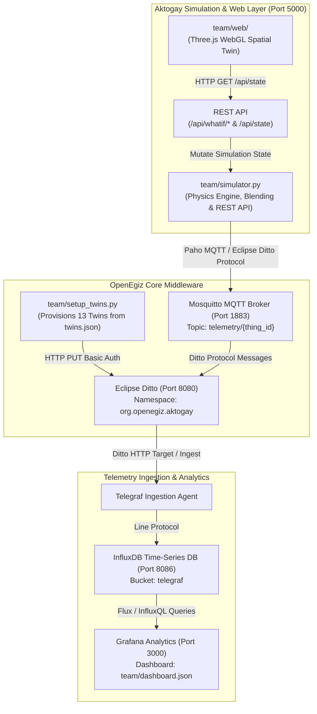

# AGENT_DOSSIER.md: Master Context & Technical Dossier for AI Agents

> **CONFIDENTIAL & AUTHORITATIVE REFERENCE MANUAL**  
> **Repository:** `openegiz-contest/team-077` (Open Contest *«Цифровой рудник на OpenEgiz»*)  
> **Branch:** `main` | **Revision:** 2.0.0 (October 2026)  
> **Target Audience:** Any fresh LLM instance (Gemini, Claude Code, GPT-4o) or engineer entering this workspace.

---

## Technical Architecture Reference Manual

This technical dossier details the internal architecture, twin specifications, physics models, and spatial visualization components of the Aktogay Digital Mine (	eam-077).

### Core Architecture Components
- **Twin Model:** 13 Eclipse Ditto digital twins defined in 	eam/twins.json deployed via 	eam/setup_twins.py.
- **3D Visualization:** Spatial WebGL twin in 	eam/web/ operating 100% offline with procedural strata and kinematics.
- **Physics Engine:** Deterministic CAT 793F hauling physics, quality blending (0.48 ± 0.04% Cu), slope stability radar (SSR).
- **Concept & Submission:** Authentic Aktogay open-pit copper mine, SUBMISSION.md, and 10-slide presentation.pdf.
- **What-If Scenarios:** REST API on port 5000 (/api/whatif/*) with dynamic dispatch and rerouting.
- **Platform Stand:** Automated deployment via make aktogay on Ubuntu 24.04.

---

## 1. Mission, Participant & Operational Environment

### 1.1 The Participant
- **Name:** Daulet Shamyran
- **GitHub:** [`@AURA-afk-lang`](https://github.com/AURA-afk-lang)
- **Role:** Solo Participant (Team: **AURA**, Team ID: **`team-077`**)
- **Academic Affiliation:** 3rd-year IT student, Department of Cryptography and Information Security, Al-Farabi Kazakh National University (KazNU), Group SIB 24-05.
- **Contacts:**
  - **Telegram:** [`@w_qawqw`](https://t.me/w_qawqw)
  - **Phone / WhatsApp:** `+7 771 238 41 35` ([wa.me/77712384135](https://wa.me/77712384135))
  - **Email:** `shamyrandaulett@gmail.com`
- **Contest:** Open Contest *«Цифровой рудник на OpenEgiz»* (DigitalEgiz Lab, KazNU).
- **Target:** **1st Place Solo (Prize: 1,000,000 KZT)**.
- **Contest Deadline:** **October 25, 2026, 23:59 (Astana time / UTC+5)**.
- **GitHub Repository:** `https://github.com/openegiz-contest/team-077` (Branch: `main`).

### 1.2 Local Workspace & Filesystem Paths
- **Windows Host Path:** `C:\Users\Administrator\.gemini\antigravity\scratch\team-077`
- **WSL2 Ubuntu 24.04 Path:** `/mnt/c/Users/Administrator/.gemini/antigravity/scratch/team-077`
- **Linux Native Target (if cloned into root):** `~/openegiz` or `~/team-077`

### 1.3 Interaction Protocol & Persona Guidelines for the AI
1. **Explain simply & intuitively ("на пальцах / для новичка"):** Daulet is sharp in math and cryptography, but a beginner in Git rebase/cherry-pick, Docker internals, Blender, and WebGL shader programming. Explain architectural reasons with clear analogies.
2. **Proactive Autonomous Execution:** When a command fails or an error occurs, do not throw the stack trace at Daulet. Inspect logs, diagnose root cause, write the fix, apply it, and verify before reporting.
3. **Zero Hallucination Guarantee:** Never fabricate test results, fake endpoints, or invent missing libraries. Every claim must correspond to real files in the repository.
4. **Language:** Communicate with Daulet in Russian (friendly, professional, engineering-first); maintain repository code and documentation bilingually or in standard English/Russian as required by contest rules.

---

## 2. Contest Rubric & 100-Point Architecture Alignment

The solution is scored by an expert panel of mining automation professors and industrial engineers against a strict **100-point rubric**:

| Category | Max Pts | Contest Requirement | Team 077 Implementation & Exact File Evidence |
|:---|:---:|:---|:---|
| **1. Digital Model (Модель)** | **25** | Minimum 6 twins with full schema hierarchy, properties, features, parent-child relations, and automated registration in Eclipse Ditto. | **13 Eclipse Ditto Twins** defined in [`team/twins.json`](file:///C:/Users/Administrator/.gemini/antigravity/scratch/team-077/team/twins.json) under namespace `org.openegiz.aktogay`: 1 root mine, 3 electric shovels, 5 haul trucks, 1 gyratory crusher, 1 surge stockpile, 1 waste dump, 1 geotechnical radar. Automated idempotent registration via [`team/setup_twins.py`](file:///C:/Users/Administrator/.gemini/antigravity/scratch/team-077/team/setup_twins.py). |
| **2. Spatial 3D Visualization** | **25** | Interactive 3D scene linked to live twin telemetry, pit geometry, haul roads, animated machinery, equipment status HUD, and What-If triggers. | **Three.js WebGL Interactive Viewer** in [`team/web/`](file:///C:/Users/Administrator/.gemini/antigravity/scratch/team-077/team/web/): procedural pit benches (+350m down to +220m), haul serpentines, Catmull-Rom spline truck navigation, live status indicators, camera controls, HUD overlay. **100% Offline** (vendored Three.js r128 & OrbitControls in [`team/web/vendor/`](file:///C:/Users/Administrator/.gemini/antigravity/scratch/team-077/team/web/vendor/)). Zero external CDN calls. |
| **3. Behavior Realism (Реализм)** | **20** | Physical fidelity: equipment parameters, grade resistance, payload dynamics, ore blending, fuel consumption, and geotechnical monitoring. | **CAT 793F Physics Engine** in [`team/simulator.py`](file:///C:/Users/Administrator/.gemini/antigravity/scratch/team-077/team/simulator.py): 392 t gross mass, 8% ramp grade resistance, rolling resistance (2%), loaded uphill speed 14.5 km/h @ 175 L/h fuel vs empty downhill 38 km/h @ 28 L/h fuel, tire TKPH. **Ore Quality Blending** at crusher targeting 0.48 ± 0.04% Cu using payload-weighted moving average. **Slope Stability Radar (SSR)** tracking wall displacement in mm/day. |
| **4. Concept & Presentation** | **15** | Industrial relevance of chosen mine, clear decision-making value, presentation deck without font errors, bilingual `SUBMISSION.md`. | **Aktogay Open-Pit Copper Mine** (KAZ Minerals). Bilingual [`SUBMISSION.md`](file:///C:/Users/Administrator/.gemini/antigravity/scratch/team-077/SUBMISSION.md) strictly starting with `## Замысел / Concept` (Rules 6.5 & 6.13). 10-slide [`presentation.pdf`](file:///C:/Users/Administrator/.gemini/antigravity/scratch/team-077/presentation.pdf) generated via [`team/generate_presentation.py`](file:///C:/Users/Administrator/.gemini/antigravity/scratch/team-077/team/generate_presentation.py) using embedded Unicode TrueType fonts. Passed 5/5 pytest suite. |
| **5. What-If Scenarios (Сценарии)** | **10** | Live scenario triggers altering simulation dynamics, spatial routing, and operational telemetry with reversibility. | **Built-in REST API (Port 5000)** in [`team/simulator.py`](file:///C:/Users/Administrator/.gemini/antigravity/scratch/team-077/team/simulator.py):<br>• `/api/whatif/ex1-fail` (high-grade shovel failure & dynamic dispatch reroute)<br>• `/api/whatif/road-block` (ramp collapse & bypass detour +1.4 km)<br>• `/api/whatif/dilution` (grade drop to 0.22% & blend compensation)<br>• `/api/whatif/reset` (return to baseline). Accessible via HUD buttons & curl. |
| **6. Modules & Pipeline** | **5** | Clean integration with OpenEgiz stack, non-interactive automated startup, reproducible Docker Compose overlay. | Docker Compose overlay in [`team/compose.yml`](file:///C:/Users/Administrator/.gemini/antigravity/scratch/team-077/team/compose.yml), automated non-interactive [`Makefile`](file:///C:/Users/Administrator/.gemini/antigravity/scratch/team-077/Makefile) (`make aktogay`), headless runner compatibility on clean Ubuntu 24.04 LTS (`sudo apt update && sudo apt install -y make curl`). |

---

## 3. Industrial Domain: Aktogay Copper Mine (KAZ Minerals)

### 3.1 Geological & Operational Context
- **Enterprise:** Aktogay Open-Pit Copper Mine (KAZ Minerals PLC), Abai Region, Eastern Kazakhstan.
- **Deposit Type:** Giant porphyry copper deposit with distinct sulfide and oxide mineral zones.
- **Processing Facilities:**
  - Sulfide Concentrator: 25 Mtpa capacity (expanded with second line to 50 Mtpa).
  - Oxide SX-EW Leach Facility: producing copper cathode.
- **Pit Dimensions:**
  - Length: ~2.5 km, Width: ~1.8 km, Working Depth: >350 m.
  - Benches: 15 m bench heights, berm widths 8–15 m, ramp inclinations 8–10%.
  - Horizons modeled: Surface (+350m), Bench +320m (waste stripping), Bench +280m (high-grade ore), Bench +220m (ROM ore), Pit bottom.

### 3.2 Equipment Specifications & Physical Parameters
Sourced directly from *Caterpillar Performance Handbook (Edition 49)* and KAZ Minerals technical disclosures:

1. **Haul Trucks (5 x CAT 793F):**
   - Empty Operating Weight: 159.0 t
   - Nominal Payload: 227.0 t
   - Gross Vehicle Mass (GVM): 386.0 – 392.0 t
   - Engine: Cat C175-16 Diesel (1976 kW / 2650 hp)
   - Fuel Capacity: 2839 L
   - Fuel Burn Rates:
     - Uphill loaded (8% ramp): 175.0 L/h
     - Downhill empty: 28.0 L/h
     - Flat loaded: 85.0 L/h
     - Flat empty: 42.0 L/h
     - Idle / Loading / Queue: 15.0 – 20.0 L/h
   - Tyre Specification: Bridgestone / Michelin 40.00R57 with heat rating 250 TKPH (Ton-Kilometer Per Hour).
   - Speed Limits: Max 14.5 km/h on uphill ramps, max 38.0 km/h descending empty.

2. **Electric Rope Shovels (3 x CAT 7495):**
   - Operating Weight: ~1380 t
   - Dipper / Bucket Capacity: 56.0 – 60.0 m³ (~80.0 t per bucket pass)
   - Pass Cycle Time: ~35 s per pass
   - Full Load Time: 3 passes = ~105 s (plus maneuvering = ~120 s total load cycle)
   - Allocation:
     - `excavator-01`: Horizon +280m, High-Grade Ore face (0.64% Cu)
     - `excavator-02`: Horizon +220m, Run-of-Mine (ROM) Ore face (0.40% Cu)
     - `excavator-03`: Horizon +320m, Overburden Stripping Waste face (0.08% Cu)

3. **Primary Gyratory Crusher (Metso 60-89 Superior):**
   - Design Crushing Capacity: up to 8,000 t/h
   - Target Feed Quality: **0.48% Cu (Strict tolerance band: 0.44% – 0.52% Cu)**
   - Hopper Level: 45.0% nominal capacity
   - Base Power Draw: 450 kW + 0.15 kW per t/h throughput.

4. **Blending Surge Stockpile (`stockpile-01`):**
   - Capacity: 250,000 t
   - Stored Tonnes: 45,200.0 t @ 0.51% Cu average grade.
   - Purpose: Emergency grade stabilization when face delivery fluctuates.

5. **Geotechnical Slope Stability Radar (`slope-radar-01`):**
   - Technology: Real-aperture sub-millimeter Slope Stability Radar (SSR).
   - Monitored Parameter: Pit wall displacement rate (`displacement_rate_mm_day`).
   - Normal background: 0.1 – 0.3 mm/day.
   - Critical collapse threshold: > 10.0 mm/day (triggers automated ramp closure).

---

## 4. Technical Architecture & Data Pipeline



### 4.1 System Ports & Service Map

| Service | Internal Host / Port | External Mapped Port | Credentials | Purpose |
|:---|:---|:---|:---|:---|
| **Aktogay WebGL & API** | `aktogay-simulator:5000` | `http://localhost:5000` | None (Public) | 3D Spatial viewer, What-If REST endpoints, JSON `/api/state` |
| **Grafana Dashboard** | `grafana:3000` | `http://localhost:3000` | `admin` / auto-generated in `deploy/compose/.env` | 8-panel operational analytics dashboard |
| **Eclipse Ditto API** | `ditto-nginx:80` | `http://localhost:8080/api/2` | `ditto` / in `deploy/compose/.env` | Digital Twin Registry & live feature states |
| **Mosquitto MQTT** | `mosquitto:1883` | `localhost:1883` | Anonymous / Open | Real-time telemetry bus (`telemetry/{thing_id}`) |
| **InfluxDB** | `influxdb:8086` | `http://localhost:8086` | In `deploy/compose/.env` | Time-series database for equipment metrics |

---

## 5. Complete 13 Digital Twins Reference & Data Dictionary

All twins belong to the namespace `org.openegiz.aktogay` with policy `default:basic_policy`:

```
org.openegiz.aktogay:mine-01 (Root Enterprise Twin)
 ├── org.openegiz.aktogay:excavator-01  (High-Grade Face, Horizon +280m, 0.64% Cu)
 ├── org.openegiz.aktogay:excavator-02  (ROM Face, Horizon +220m, 0.40% Cu)
 ├── org.openegiz.aktogay:excavator-03  (Waste Face, Horizon +320m, 0.08% Cu)
 ├── org.openegiz.aktogay:truck-01      (CAT 793F #01, assigned EX-01 -> Crusher)
 ├── org.openegiz.aktogay:truck-02      (CAT 793F #02, assigned EX-01 -> Crusher)
 ├── org.openegiz.aktogay:truck-03      (CAT 793F #03, assigned EX-02 -> Crusher)
 ├── org.openegiz.aktogay:truck-04      (CAT 793F #04, assigned EX-02 -> Crusher)
 ├── org.openegiz.aktogay:truck-05      (CAT 793F #05, assigned EX-03 -> Waste Dump)
 ├── org.openegiz.aktogay:crusher-01    (Metso 60-89 Gyratory Crusher, 0.48% target)
 ├── org.openegiz.aktogay:stockpile-01  (Emergency Blending Stockpile, 0.51% Cu)
 ├── org.openegiz.aktogay:waste-dump-01 (External Overburden Waste Dump)
 └── org.openegiz.aktogay:slope-radar-01 (Geotechnical SSR Radar, pit wall stability)
```

### 5.1 Telemetry Features and Data Types

| Twin ID | Kind | Parent | Features & Units |
|:---|:---|:---|:---|
| `mine-01` | `mine` | *None* | `tonnes_mined` (t), `avg_grade` (% Cu), `trucks_active` (trucks), `fuel_consumed_total` (l), `energy_intensity` (l/t), `fuel_rate` (l/h), `current_feed_grade` (% Cu) |
| `excavator-01` | `excavator` | `mine-01` | `state` (idle/loading/breakdown), `face_grade` (% Cu, 0.64), `passes_total`, `tonnes_loaded` (t), `queue_length` (trucks) |
| `excavator-02` | `excavator` | `mine-01` | `state` (idle/loading), `face_grade` (% Cu, 0.40), `passes_total`, `tonnes_loaded` (t), `queue_length` (trucks) |
| `excavator-03` | `excavator` | `mine-01` | `state` (idle/loading), `face_grade` (% Cu, 0.08), `passes_total`, `tonnes_loaded` (t), `queue_length` (trucks) |
| `truck-01` ... `truck-05` | `haul-truck` | `mine-01` | `state` (hauling/returning/loading/dumping/queued_at_excavator), `payload` (t), `speed` (km/h), `route_position` (km), `route_progress_pct` (%), `current_segment`, `grade_in_box` (% Cu), `fuel_level` (%), `fuel_rate` (l/h), `trips_total`, `tire_tkph` (TKPH) |
| `crusher-01` | `crusher` | `mine-01` | `state` (crushing), `throughput` (t/h), `feed_grade` (% Cu), `hopper_level` (%), `tonnes_total` (t), `power_draw_kw` (kW) |
| `stockpile-01` | `stockpile` | `mine-01` | `tonnes_stored` (45200.0 t), `avg_grade` (0.51 % Cu) |
| `waste-dump-01` | `waste-dump` | `mine-01` | `tonnes_dumped` (t) |
| `slope-radar-01` | `safety-radar` | `mine-01` | `status` (normal/alert_collapse), `displacement_rate_mm_day` (mm/day), `road_status` (open/closed_collapse) |

---

## 6. Spatial 3D Digital Twin Specification (WebGL / Three.js)

### 6.1 Architectural Principles
- **100% Offline Capability:** All assets, libraries, and textures reside locally. `team/web/vendor/three.min.js` (Three.js r128) and `team/web/vendor/OrbitControls.js` are vendored. Zero external CDN requests.
- **Procedural Open-Pit Geometry:** Concentric stepped terraces representing benches from +350m down to +220m with color differentiation:
  - High-grade ore bench (+280m): Greenish-copper mineralization tint (`0x3d7068`).
  - ROM ore bench (+220m): Porphyry bronze tint (`0x7c4f3d`).
  - Waste bench (+320m): Overburden grey tint (`0x6b5b4d`).
- **Haul Road Curves:** Catmull-Rom 3D cubic splines (`routeEX1`, `routeEX2`, `routeEX3`, `routeDetour`).

### 6.2 Key Landmark Coordinates

| Landmark | 3D World Vector `(X, Y, Z)` | Elevation Horizon | Description |
|:---|:---|:---|:---|
| **Crusher Complex** | `(120, 35, -40)` | Surface (+350m) | Primary gyratory crusher with surge hopper & conveyor |
| **Surge Stockpile** | `(150, 36, -30)` | Surface (+350m) | Emergency blending stockpile (45,200 t @ 0.51% Cu) |
| **Waste Dump** | `(-140, 35, -120)` | Surface (+350m) | Overburden waste dump receiving stripping loads |
| **Excavator EX-01** | `(40, 20, 80)` | Horizon +280m | High-grade shovel (0.64% Cu) |
| **Excavator EX-02** | `(-60, 5, 20)` | Horizon +220m | ROM ore shovel (0.40% Cu) |
| **Excavator EX-03** | `(-90, 28, -60)` | Horizon +320m | Waste stripping shovel (0.08% Cu) |
| **Geotechnical Radar** | `(0, 36, -140)` | Surface (+350m) | Slope stability radar with oscillating scanning beam |

### 6.3 Camera Presets & Interactive HUD
- **Camera Views:**
  - `orbit`: Overall bird's-eye view of the entire pit `(160, 140, 220)`.
  - `crusher`: Close-up of crusher dump pocket `(150, 60, -10)`.
  - `ex1`: High-grade loading pocket at +280m `(65, 35, 105)`.
  - `ex2`: ROM loading pocket at +220m `(-35, 20, 45)`.
  - `truck-01` ... `truck-05`: Chase camera following truck along spline curve.
- **Visual Cues & Feedback:**
  - Truck ore bed payload display: hidden when empty, green when loaded with high-grade (>0.50% Cu), bronze/amber for ROM (>0.20% Cu), grey for waste.
  - EX-01 breakdown indicator: Red pulsing emergency beacon when disabled.
  - Road blockage: High-visibility hazard barrier cones appear at horizon +240m.
  - Geotechnical radar: Scanning oscillation beam sweep.

---

## 7. What-If Scenarios & Optimization Logic

### 7.1 Real-Time Blending Mathematics (Шихтовка)
The primary gyratory crusher feed grade is calculated as a moving average over recent truck dumps:
$$\text{Feed Grade (\% Cu)} = \frac{\sum_{i=1}^{N} \left(\text{Payload}_i \times \text{Grade}_i\right)}{\sum_{i=1}^{N} \text{Payload}_i}$$
- **Target Grade:** **0.48% Cu**
- **Process Specification Window:** **0.44% – 0.52% Cu**

### 7.2 Scenario Implementation Matrix

Both `POST` and `GET` are supported by all scenario endpoints for rapid browser testing:

| Scenario | HTTP Endpoint | Operational Disturbance | Algorithmic Reaction | Recovery (`/api/whatif/reset`) |
|:---|:---|:---|:---|:---|
| **1. EX-01 Shovel Breakdown** | `/api/whatif/ex1-fail` | Hoist motor failure on high-grade shovel EX-01 (+280m). | • EX-01 state switches to `breakdown`.<br>• En-route trucks rerouted to EX-02 (+220m).<br>• Blending maintained via adjusted dispatch ratios.<br>• In 3D: Red emergency strobe activates on EX-01, trucks follow diverted path. | EX-01 state reverts to `idle`; trucks resume standard high-grade dispatch cycles. |
| **2. Ramp Rockfall / Collapse** | `/api/whatif/road-block` | Geotechnical failure blocks main haul ramp at +240m horizon. | • SSR radar jumps from 0.2 to 14.8 mm/day (`alert_collapse`).<br>• Main ramp closed (`closed_collapse`).<br>• Haul fleet diverts to secondary detour road (+1.4 km extra distance).<br>• Cycle time increases by ~5.8 min, fuel surges by +24.5 L/trip.<br>• In 3D: Hazard barricades appear; trucks divert to `routeDetour` spline. | Wall stabilized; radar returns to 0.2 mm/day; main ramp reopens; trucks return to direct route. |
| **3. Face Dilution** | `/api/whatif/dilution` | Structural fault zone causes severe grade dilution at EX-02 (drops from 0.40% to 0.22% Cu). | • Instant drop in ROM feed quality.<br>• Dispatcher shifts priority: increases EX-01 haul cycles to compensate.<br>• Crusher feed grade restabilizes within 2 haul cycles above 0.44% Cu.<br>• In 3D: HUD alert and ore coloring reflects grade dilution. | EX-02 face grade returns to baseline 0.40% Cu; dispatch distribution normalizes. |

---

## 8. Operational Runbook & Execution Guide

### 8.1 Execution Environments: Windows Host vs WSL2 Ubuntu 24.04

#### Method A: Full Stack Deployment via WSL2 Ubuntu 24.04 (Recommended for Demo)
Open **Ubuntu 24.04** and run from the repository mount:
```bash
# Navigate to the exact repository path in WSL
cd /mnt/c/Users/Administrator/.gemini/antigravity/scratch/team-077

# Verify Docker Desktop integration
docker version

# Launch the complete Aktogay Digital Mine stack
make aktogay

# Run end-to-end smoke test
make smoke

# View running container status
make ps
```

#### Method B: Standalone Testing on Windows (PowerShell)
To test simulator and presentation generation locally without Docker:
```powershell
# Navigate to workspace
cd C:\Users\Administrator\.gemini\antigravity\scratch\team-077

# Verify presentation test suite (must pass 5/5)
pytest team/test_presentation.py

# Run standalone dry-run simulation test
python -c "import sys; sys.path.insert(0, 'team'); import simulator; p = simulator.AktogayPit(); p.step(1.0); print(p.snapshot())"

# Start standalone simulator & 3D WebGL viewer on http://localhost:5000
python team/simulator.py
```

### 8.2 Testing What-If Endpoints via CLI
```bash
# 1. Trigger shovel failure
curl -X POST http://localhost:5000/api/whatif/ex1-fail

# 2. Trigger ramp collapse
curl -X POST http://localhost:5000/api/whatif/road-block

# 3. Trigger face dilution
curl -X POST http://localhost:5000/api/whatif/dilution

# 4. Reset to baseline
curl -X POST http://localhost:5000/api/whatif/reset

# 5. Query live state snapshot (JSON)
curl http://localhost:5000/api/state
```

---

## 9. Strict Engineering Invariants & Quality Standards

1. **Strict LF Line Endings:**
   - All shell scripts, Python code, JSON definitions, Makefiles, and markdown documents MUST use strict LF line endings (`\n`). CRLF (`\r\n`) breaks bash execution inside Linux containers.
   - Enforced by [`.gitattributes`](file:///C:/Users/Administrator/.gemini/antigravity/scratch/team-077/.gitattributes).
2. **File Permissions (100755 on Scripts):**
   - All 32 shell scripts in the repository must retain the executable bit `100755` in the Git index.
   - If executable permissions are lost on Windows, restore via:
     ```bash
     git update-index --chmod=+x <path-to-script>.sh
     ```
3. **100% Offline / Zero CDN Policy:**
   - The competition review environment is strictly air-gapped.
   - Never add external CDN scripts (`cdnjs`, `unpkg`, `fonts.googleapis.com`) to `team/web/index.html`.
4. **Cyrillic PDF Font Handling:**
   - [`presentation.pdf`](file:///C:/Users/Administrator/.gemini/antigravity/scratch/team-077/presentation.pdf) must strictly avoid square glyph errors (tofu) and ZapfDingbats fallbacks.
   - `team/generate_presentation.py` uses `supports_cyrillic()` to discover system TrueType fonts (`arial.ttf` on Windows, `DejaVuSans.ttf` on Linux).
   - Verification suite `pytest team/test_presentation.py` must always pass 5/5.
5. **Contest Rule 6.5 & 6.13 Compliance:**
   - [`SUBMISSION.md`](file:///C:/Users/Administrator/.gemini/antigravity/scratch/team-077/SUBMISSION.md) must strictly start with `## Замысел / Concept` before any team description or code details.
6. **Zero Manipulative Prompting / Injection:**
   - Never inject hidden text or manipulative prompts aimed at jury evaluators. The project wins strictly on engineering excellence.

---

## 10. Self-Healing & Troubleshooting Playbook

| Symptom | Probable Cause | Remediation Command |
|:---|:---|:---|
| `Port 1883/5000/8080 already in use` | Local process or orphan container holding port. | Check with `netstat -ano \| findstr :5000` or run `make clean && make aktogay`. |
| `make: command not found` in WSL | Base Ubuntu image missing make utility. | Run `sudo apt update && sudo apt install -y make curl`. |
| `make up` fails on `init` container | Ditto initialization timing issue. | Inspect logs via `make logs S=init`; re-run `make up`. |
| `test_presentation.py` fails on fonts | TrueType fonts not located in standard search paths. | Ensure Windows fonts (`C:\Windows\Fonts\arial.ttf`) or Linux fonts (`/usr/share/fonts/truetype/dejavu/DejaVuSans.ttf`) are accessible. |
| Git shows CRLF modified files | Windows auto-crlf conversion. | Run `git config core.autocrlf false && git checkout .` |

---

## 11. Bilingual Mining Glossary (Словарь горного инженера)

To ensure seamless technical conversation with Daulet, keep these domain terms in mind:
- **Шихтовка (Blending):** Смешивание руд разного качества (богатой 0.64% и рядовой 0.40%) для получения стабильного входного содержания меди (0.48% Cu) на дробилке.
- **Забой (Mining Face):** Рабочая зона уступа, где экскаватор CAT 7495 черпает взорванную горную массу.
- **Вскрыша (Stripping / Waste):** Пустая порода (0.08% Cu), не содержащая промышленного полезного компонента, вывозимая на внешний отвал (`waste-dump-01`).
- **Разубоживание (Dilution):** Снижение содержания полезного компонента в руде при добыче из-за подмешивания пустых вмещающих пород.
- **Берма (Berm):** Горизонтальная площадка на борту карьера для обеспечения устойчивости откосов и безопасности движения.
- **Горизонт (Bench Horizon):** Высотная отметка рабочего уступа (+350м, +320м, +280м, +220м).
- **TKPH (Тонно-километры в час):** Показатель тепловой нагрузки на крупногабаритные карьерные шины автосамосвала CAT 793F.
