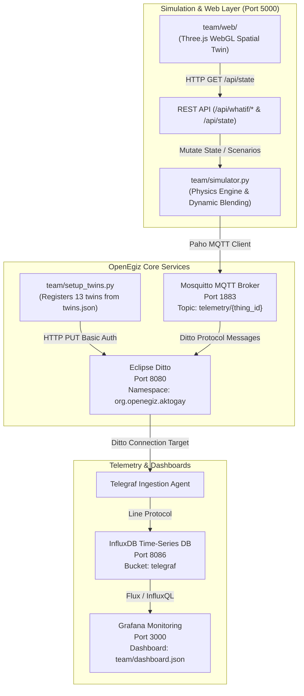

# AGENT_DOSSIER.md: Master Context & Technical Dossier for AI Agents

> **CONFIDENTIAL & AUTHORITATIVE REFERENCE MANUAL**  
> **Repository:** `team-077` (Open Contest *«Цифровой рудник на OpenEgiz»*)  
> **Current Revision:** 1.0.0 (October 2026)  
> **Target Audience:** Any fresh LLM instance, Claude Code, Gemini, Copilot, or human engineer entering this workspace.

---

## ⚡ Quickstart for the New AI ("Read This First")

If you are a fresh AI model in a newly opened context window:
1. **You are pair-programming with Daulet Shamyran (`@AURA-afk-lang`)**, a 3rd-year IT student at KazNU (Dept. of Cryptography and Computer Security).
2. **The Goal:** Win 1st Place Solo (1,000,000 KZT) in the Open Contest *«Цифровой рудник на OpenEgiz»* (DigitalEgiz Lab, KazNU). Deadline: **October 25, 2026, 23:59 (Astana / UTC+5)**.
3. **The Project:** An industrial-grade digital twin of the **Aktogay Open-Pit Copper Mine** (KAZ Minerals) running on the open-source **OpenEgiz** platform (Eclipse Ditto + MQTT + Telegraf + InfluxDB + Grafana + Three.js WebGL).
4. **Your Persona:** Highly proactive, technically rigorous, deeply respectful and supportive. Explain complex concepts simply ("на пальцах / для новичка"), execute commands autonomously, verify before reporting, never hallucinate, and never give broken code.
5. **Core Repository Commands:**
   - Run the Aktogay Digital Mine stack: `make aktogay` (3D twin at `http://localhost:5000`, Grafana at `http://localhost:3000`).
   - Run end-to-end smoke test: `make smoke`.
   - Verify presentation PDF generation: `pytest team/test_presentation.py` (must pass 5/5).
   - Stop simulator / stack: `make aktogay-stop` / `make down`.

---

## 1. Mission, Participant & Human Context

### 1.1 The Participant
- **Name:** Daulet Shamyran
- **GitHub:** [`@AURA-afk-lang`](https://github.com/AURA-afk-lang)
- **Role:** Solo Participant (Team: **AURA**, Team ID: **`team-077`**)
- **Academic Affiliation:** 3rd-year student, Department of Cryptography and Information Security, Al-Farabi Kazakh National University (KazNU), Group SIB 24-05.
- **Contacts:**
  - **Telegram:** [`@w_qawqw`](https://t.me/w_qawqw)
  - **Phone / WhatsApp:** `+7 771 238 41 35` ([wa.me/77712384135](https://wa.me/77712384135))
  - **Email:** `shamyrandaulett@gmail.com`

### 1.2 User Interaction Guidelines for the AI
- **Background Level:** Daulet possesses strong analytical drive, cryptographic thinking, and dedication, but is a beginner regarding Git branching/rebasing, Docker daemon internals, Blender, and WebGL/Three.js internals.
- **Communication Protocol:**
  - **Explain simply & clearly:** When explaining architectural decisions, provide intuitive analogies without condescension.
  - **Autonomous Execution:** Do not give Daulet half-baked shell commands and say "go run this and tell me the error". Proactively inspect errors, read logs, formulate the fix, apply it, and verify it.
  - **Zero Hallucination:** If a metric, API route, or Docker service does not exist or fails, state it plainly. Never fake test results.
  - **Language:** Daulet communicates in Russian (often informal/direct); technical documentation is maintained bilingually or in standard English/Russian as required by contest rules.

---

## 2. Contest Rubric & 100-Point Architecture Alignment

The contest is evaluated by a jury of industrial automation engineers and professors against a strict **100-point rubric**:

| Category | Points | Rubric Requirements | Team 077 Implementation & Exact File Evidence |
|:---|:---:|:---|:---|
| **1. Digital Model (Модель)** | **25** | Minimum 6 twins with full schema hierarchy, properties, features, parent-child relations, and automated registration in Eclipse Ditto. | **13 Eclipse Ditto Twins** defined in [`team/twins.json`](file:///C:/Users/Administrator/.gemini/antigravity/scratch/team-077/team/twins.json) under namespace `org.openegiz.aktogay`: 1 mine root, 3 shovels, 5 haul trucks, 1 crusher, 1 stockpile, 1 waste dump, 1 slope radar. Registered idempotently via [`team/setup_twins.py`](file:///C:/Users/Administrator/.gemini/antigravity/scratch/team-077/team/setup_twins.py). |
| **2. Spatial 3D Visualization** | **25** | Interactive 3D scene linked to live twin telemetry, pit geometry, haul roads, animated machinery, equipment status HUD, and What-If triggers. | **Three.js WebGL Interactive Viewer** in [`team/web/`](file:///C:/Users/Administrator/.gemini/antigravity/scratch/team-077/team/web/): procedural pit benches, haul serpentines, Catmull-Rom spline truck navigation, live status indicators, camera controls, HUD overlay. **100% Offline** (vendored Three.js r128 & OrbitControls in [`team/web/vendor/`](file:///C:/Users/Administrator/.gemini/antigravity/scratch/team-077/team/web/vendor/)). |
| **3. Behavior Realism (Реализм)** | **20** | Physical fidelity: equipment parameters, grade resistance, payload dynamics, ore blending, fuel consumption, and geotechnical monitoring. | **CAT 793F Physics Engine** in [`team/simulator.py`](file:///C:/Users/Administrator/.gemini/antigravity/scratch/team-077/team/simulator.py): 392 t gross mass, 8% ramp grade resistance, rolling resistance (2%), loaded uphill speed 14.5 km/h @ 175 L/h fuel vs empty downhill 38 km/h @ 28 L/h fuel, tire TKPH. **Ore Quality Blending** at crusher targeting 0.48 ± 0.04% Cu. **Slope Radar** tracking pit wall displacement in mm/day. |
| **4. Concept & Presentation** | **15** | Industrial relevance of chosen mine, clear decision-making value, presentation deck without font errors, bilingual `SUBMISSION.md`. | **Aktogay Open-Pit Copper Mine** (KAZ Minerals). Bilingual [`SUBMISSION.md`](file:///C:/Users/Administrator/.gemini/antigravity/scratch/team-077/SUBMISSION.md) strictly starting with `## Замысел / Concept` (Rules 6.5 & 6.13). 10-slide [`presentation.pdf`](file:///C:/Users/Administrator/.gemini/antigravity/scratch/team-077/presentation.pdf) generated via [`team/generate_presentation.py`](file:///C:/Users/Administrator/.gemini/antigravity/scratch/team-077/team/generate_presentation.py) using embedded Unicode TrueType fonts. |
| **5. What-If Scenarios (Сценарии)** | **10** | Live scenario triggers altering simulation dynamics, spatial routing, and operational telemetry with reversibility. | **Built-in REST API (Port 5000)** in [`team/simulator.py`](file:///C:/Users/Administrator/.gemini/antigravity/scratch/team-077/team/simulator.py):<br>• `/api/whatif/ex1-fail` (high-grade shovel failure & rerouting)<br>• `/api/whatif/road-block` (ramp collapse & bypass detour)<br>• `/api/whatif/dilution` (grade drop & blend compensation)<br>• `/api/whatif/reset` (return to baseline). Accessible via HUD buttons & curl. |
| **6. Modules & Pipeline** | **5** | Clean integration with OpenEgiz stack, non-interactive automated startup, reproducible Docker Compose overlay. | Docker Compose overlay in [`team/compose.yml`](file:///C:/Users/Administrator/.gemini/antigravity/scratch/team-077/team/compose.yml), automated non-interactive [`Makefile`](file:///C:/Users/Administrator/.gemini/antigravity/scratch/team-077/Makefile) (`make aktogay`), headless runner compatibility on clean Ubuntu 24.04 LTS. |

---

## 3. Industrial Domain: Aktogay Copper Mine

### 3.1 Geological & Operational Context
- **Enterprise:** Aktogay Open-Pit Copper Mine (KAZ Minerals), Abai Region, Eastern Kazakhstan.
- **Deposit Type:** Supergiant porphyry copper deposit.
- **Primary Processing Plants:** Sulfide Concentrator (25 Mtpa) and Oxide SX-EW Leach Facility.
- **Pit Dimensions:** Multi-kilometer open pit with working benches from +320m down to +220m (and deepening), 15m bench heights, 8–10% ramp inclination.

### 3.2 Equipment Fleet Specifications
Parameters sourced directly from *Caterpillar Performance Handbook (Edition 49)* and KAZ Minerals technical filings:
1. **Haul Trucks (CAT 793F):**
   - Empty Operating Weight: 159.0 t
   - Rated Payload: 227.0 t
   - Gross Vehicle Mass (GVM): 386–392 t
   - Diesel Engine: Cat C175-16 (1976 kW / 2650 hp)
   - Fuel Tank Capacity: 2839 L
   - Tyre Rating: 250 TKPH (Ton-Kilometer Per Hour)
2. **Electric Rope Shovels (CAT 7495):**
   - Operating Mass: ~1380 t
   - Dipper / Bucket Capacity: 56–60 m³ (~80–85 t per pass)
   - Loading Cycle: ~35 s per pass (3 passes to fill a 227t truck, ~105–120 s total load time).
3. **Primary Gyratory Crusher (Metso 60-89 Superior):**
   - Design Throughput: Up to 8,000 t/h.
   - Target Feed Quality: **0.48% Cu (Acceptable tolerance: 0.44% – 0.52% Cu)**.

---

## 4. Technical Architecture & Data Pipeline



### 4.1 Digital Twin Hierarchy (13 Twins)

All twins belong to namespace `org.openegiz.aktogay`:

```
org.openegiz.aktogay:mine-01 (Root Enterprise Twin)
 ├── org.openegiz.aktogay:excavator-01  (High-Grade Face, +280m, 0.64% Cu)
 ├── org.openegiz.aktogay:excavator-02  (ROM Face, +220m, 0.40% Cu)
 ├── org.openegiz.aktogay:excavator-03  (Waste Stripping Face, +320m, 0.08% Cu)
 ├── org.openegiz.aktogay:truck-01      (CAT 793F, assigned EX-01 -> Crusher)
 ├── org.openegiz.aktogay:truck-02      (CAT 793F, assigned EX-01 -> Crusher)
 ├── org.openegiz.aktogay:truck-03      (CAT 793F, assigned EX-02 -> Crusher)
 ├── org.openegiz.aktogay:truck-04      (CAT 793F, assigned EX-02 -> Crusher)
 ├── org.openegiz.aktogay:truck-05      (CAT 793F, assigned EX-03 -> Waste Dump)
 ├── org.openegiz.aktogay:crusher-01    (Metso 60-89 Gyratory Crusher, 0.48% target)
 ├── org.openegiz.aktogay:stockpile-01  (Emergency Blending Stockpile, 0.52% Cu)
 ├── org.openegiz.aktogay:waste-dump-01 (External Overburden Waste Dump)
 └── org.openegiz.aktogay:slope-radar-01 (Geotechnical Slope Stability Radar, SSR)
```

---

## 5. File Inventory & Repository Map

```
team-077/
├── .gitattributes             # Enforces strict LF line endings across all platforms
├── .gitignore                 # Excludes caches, temporary artifacts, and credentials
├── AGENTS.md                  # Contest instructions for AI agents
├── CLAUDE.md                  # Pointers for Claude Code
├── AGENT_DOSSIER.md           # [THIS FILE] Definitive master context dossier
├── Makefile                   # Non-interactive CLI automation (up, aktogay, smoke, clean)
├── OPENEGIZ.md                # Platform documentation (English)
├── OPENEGIZ.ru.md             # Platform documentation (Russian)
├── README.md                  # Repository readme
├── ROADMAP.md                 # Upstream development roadmap
├── SUBMISSION.md              # Bilingual contest submission document (Rules 6.5 & 6.13)
├── presentation.pdf           # 10-slide presentation deck with embedded Unicode TrueType fonts
├── bootstrap.sh               # OpenEgiz installation script (executable bit 100755)
├── deploy/
│   └── compose/
│       ├── docker-compose.yml # Base OpenEgiz compose definition (Ditto, MQTT, InfluxDB, Grafana)
│       └── .env               # Auto-generated runtime credentials (git-ignored)
├── scripts/                   # 10 automated test, deployment, and preflight bash scripts (100755)
└── team/
    ├── Dockerfile             # Container definition for setup and simulator (Python 3.12-slim)
    ├── compose.yml            # Docker Compose overlay for Aktogay Digital Mine
    ├── dashboard.json         # 8-panel Grafana dashboard for Aktogay operations
    ├── generate_presentation.py # ReportLab PDF generator using system TrueType fonts
    ├── requirements.txt       # Python dependencies (paho-mqtt)
    ├── setup_twins.py         # Automated idempotent twin registration in Eclipse Ditto
    ├── simulator.py           # Physics engine, dynamic ore blending, REST API & static server
    ├── test_presentation.py   # Pytest suite validating presentation.pdf structure & fonts (5/5)
    ├── twins.json             # Canonical JSON definitions for all 13 Ditto twins
    └── web/
        ├── index.html         # WebGL viewer UI layout and HUD controls
        ├── app.js             # Three.js 3D scene, procedural terrain, splines & telemetry loop
        └── vendor/
            ├── three.min.js   # Vendored Three.js r128 (100% offline, zero CDN)
            └── OrbitControls.js # Vendored OrbitControls (100% offline, zero CDN)
```

---

## 6. What-If Scenarios & Mathematical Logic

The simulator implements real-time reactive optimization for dispatching and ore blending:

```
Weighted Crusher Feed Grade = (Σ [Payload_i × Grade_in_box_i]) / (Σ Payload_i)
Target: 0.48% Cu (Tolerance Band: 0.44% - 0.52% Cu)
```

### Scenario Matrix:

| Scenario ID | Endpoint (`POST`) | Trigger Mechanism | Physical / Operational Reaction | Recovery (`/api/whatif/reset`) |
|:---|:---|:---|:---|:---|
| **`ex1-fail`** | `/api/whatif/ex1-fail` | Mechanical breakdown of high-grade shovel EX-01 (e.g. hoist motor fault). | • EX-01 throughput drops to 0 t/h.<br>• High-grade ore feed halted.<br>• Dispatch algorithm reroutes trucks to `stockpile-01` (0.52% Cu).<br>• Blending is preserved within 0.48 ± 0.04% Cu.<br>• In 3D: Red emergency strobe on EX-01, updated spline trajectories. | EX-01 returns to operational state; trucks resume normal face cycles. |
| **`road-block`** | `/api/whatif/road-block` | Geotechnical bench failure or rockfall blocking main ramp at +240m horizon. | • Main haul road marked impassable.<br>• Trucks dynamically reroute to secondary bypass serpentine.<br>• Haul distance increases by +1.4 km.<br>• Uphill cycle time increases by ~5.8 minutes.<br>• Fuel consumption surges proportionally (+24.5 L/cycle).<br>• In 3D: High-visibility barrier cones appear; trucks divert to bypass spline. | Ramp cleared; trucks return to high-speed main ramp. |
| **`dilution`** | `/api/whatif/dilution` | Geological fault encounter causing unexpected dilution at EX-02 (grade drops from 0.40% to 0.22% Cu). | • Feed grade immediately dips.<br>• Dispatcher shifts cycle weighting: increases EX-01 allocation to 65% of total payload.<br>• Crusher feed grade restabilizes above 0.45% Cu within 2 haul cycles.<br>• In 3D: HUD alert indicates blend compensation active. | Face grade at EX-02 resets to baseline 0.40% Cu; dispatch balance normalizes. |

---

## 7. Operational Runbook: Commands & Execution

### 7.1 Running on Windows vs WSL2
- **Host System:** Windows with Docker Desktop 28+ and WSL2.
- **Docker Compose Stack:** OpenEgiz is designed to run in a Linux environment. On Windows, run Docker commands inside WSL2 Ubuntu 24.04:
  ```bash
  wsl -d Ubuntu-24.04
  cd /path/to/team-077
  make aktogay
  ```
- **Local Testing on Windows Directly (PowerShell):**
  - Run python scripts directly with Python 3.12+:
    ```powershell
    python team/simulator.py --dry-run
    pytest team/test_presentation.py
    ```

### 7.2 Core Lifecycle Commands

| Action | Command | Notes |
|:---|:---|:---|
| **Start Full Aktogay Mine** | `make aktogay` | Builds container, provisions 13 twins, starts simulator & 3D WebGL on port 5000, mounts Grafana dashboard on port 3000. |
| **Stop Simulator** | `make aktogay-stop` | Pauses simulator; retains InfluxDB history and Ditto twins. |
| **Run Smoke Test** | `make smoke` | Validates end-to-end data pipeline: MQTT → Ditto → Telegraf → InfluxDB → Grafana. |
| **Check Services** | `make ps` | Displays status of all Docker Compose containers. |
| **Tail Service Logs** | `make logs S=aktogay-simulator` | Streams live output from the Aktogay simulator. |
| **Tear Down & Purge** | `make clean` | Stops all containers and purges local volumes and `.env` credentials. |

### 7.3 Testing What-If Endpoints via CLI
```bash
# Trigger shovel EX-01 breakdown
curl -X POST http://localhost:5000/api/whatif/ex1-fail

# Trigger haul ramp collapse
curl -X POST http://localhost:5000/api/whatif/road-block

# Trigger severe face dilution
curl -X POST http://localhost:5000/api/whatif/dilution

# Reset all scenarios to baseline
curl -X POST http://localhost:5000/api/whatif/reset

# Query live simulation snapshot (JSON)
curl http://localhost:5000/api/state
```

---

## 8. Invariants & Strict Engineering Rules

1. **Line Endings (Strict LF):**
   - All shell scripts (`*.sh`), Python files (`*.py`), JSON (`*.json`), Makefiles, and markdown (`*.md`) must strictly use LF line endings.
   - Enforced by [`.gitattributes`](file:///C:/Users/Administrator/.gemini/antigravity/scratch/team-077/.gitattributes). Never commit CRLF.
2. **File Permissions (100755 on Scripts):**
   - All 32 shell scripts in the repository must maintain the executable bit (`100755` in git tree).
   - If a script loses its executable bit on Windows, restore it using:
     ```bash
     git update-index --chmod=+x <path-to-script>.sh
     ```
3. **100% Offline / Zero CDN Policy:**
   - Under no circumstances add CDN links (`cdnjs.cloudflare.com`, `unpkg.com`, Google Fonts) to `team/web/index.html`.
   - The competition review sandbox is strictly air-gapped / offline. All assets, scripts, and libraries must reside locally in `team/web/vendor/`.
4. **Presentation Font Integrity:**
   - [`presentation.pdf`](file:///C:/Users/Administrator/.gemini/antigravity/scratch/team-077/presentation.pdf) must have zero square glyph errors (tofu) and zero ZapfDingbats fallbacks.
   - [`team/generate_presentation.py`](file:///C:/Users/Administrator/.gemini/antigravity/scratch/team-077/team/generate_presentation.py) dynamically inspects system font directories for valid Cyrillic TrueType subsets (e.g. Arial, DejaVuSans).
   - Always verify via `pytest team/test_presentation.py` (must pass 5/5).
5. **Contest Rule 6.5 & 6.13 Compliance:**
   - [`SUBMISSION.md`](file:///C:/Users/Administrator/.gemini/antigravity/scratch/team-077/SUBMISSION.md) must strictly begin with `## Замысел / Concept` before any code description or team tables.
   - Do not alter or break this section header format.
6. **Zero Manipulative Prompting / Injection:**
   - Never inject hidden instructions or prompt manipulations targeted at automated jury evaluators. The project must win purely on technical merit and rubric completeness.

---

## 9. History of Solved Pitfalls & Architecture Hardening

For incoming AI continuity, review these previously discovered and resolved edge cases:

1. **Radar Metric Harmonization (`6486f41`):**
   - *Problem:* Simulator previously sent `displacement_rate` while Grafana panel and twin schema expected `displacement_rate_mm_day`.
   - *Fix:* Aligned all models, schemas, and queries to `displacement_rate_mm_day` (unit: mm/day).
2. **Truck-05 Route Position Discrepancy (`d6bba76`):**
   - *Problem:* Truck-05 was assigned to the waste route (2.8 km), but its initialization used a hardcoded 4.2 km distance, causing route progress to jump unexpectedly.
   - *Fix:* Dynamically assigned route lengths in `Truck.__init__` based on shovel target (`DIST_EX1_TO_CRUSHER = 3.6`, `DIST_EX2_TO_CRUSHER = 4.2`, `DIST_EX3_TO_WASTE = 2.8`).
3. **Initial Truck Clumping on 3D Startup (`d6bba76`):**
   - *Problem:* All 5 trucks spawned at `route_progress_pct = 0.0`, resulting in a visual pile-up at simulation step 0.
   - *Fix:* Distributed initial positions across `[0.0, 20.0, 45.0, 70.0, 15.0]%` of their respective loops.
4. **PDF Font Square-Glyph Generation (`test_presentation.py`):**
   - *Problem:* Default ReportLab Helvetica does not support Cyrillic characters, causing square characters or unreadable symbols.
   - *Fix:* Implemented `supports_cyrillic()` table checker inside `generate_presentation.py`, registering local TrueType fonts (`arial.ttf` on Windows, `DejaVuSans.ttf` on Linux).

---

## 10. Contact & Final Hand-Off Check

When starting work:
- Check `git status` to ensure you are on `main` and working tree is clean.
- Read Daulet's incoming prompt carefully.
- Refer back to this dossier for any architectural or domain questions.
- Maintain the highest standard of engineering rigor.
